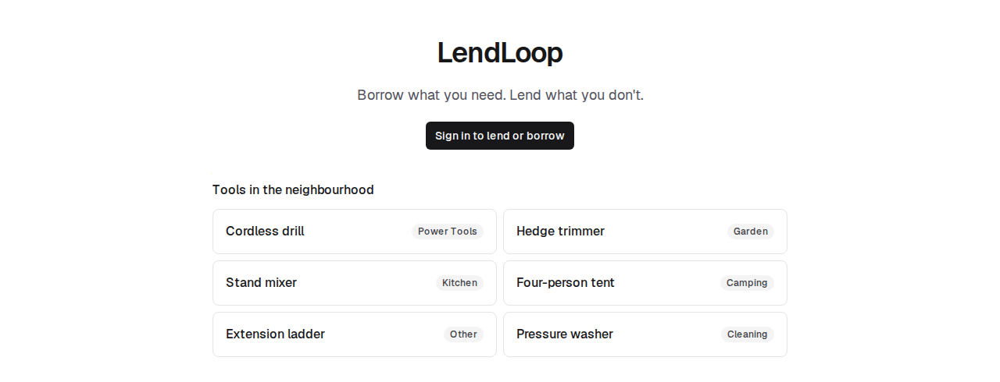
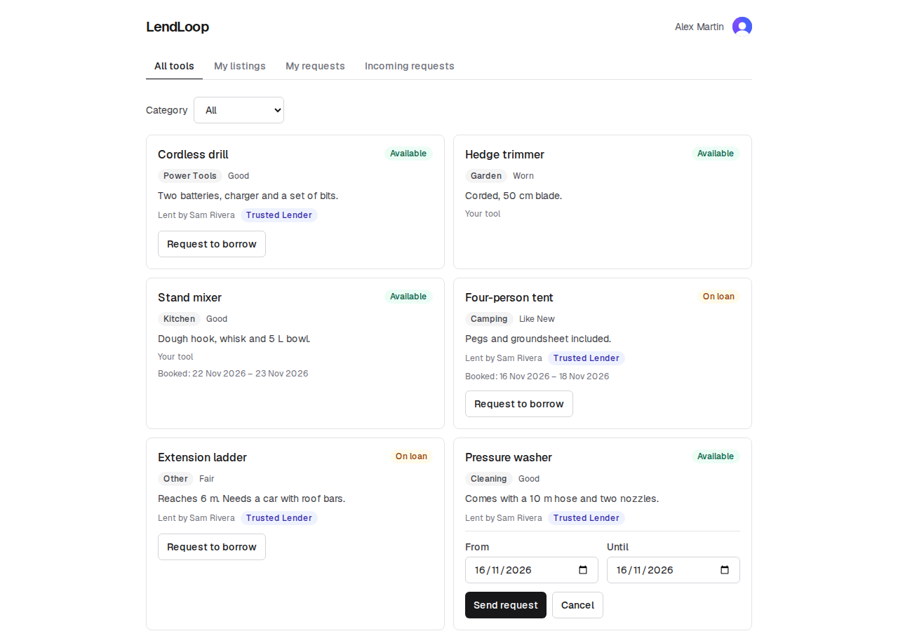
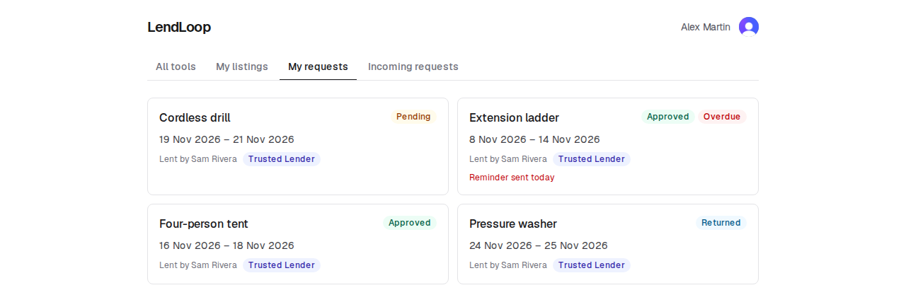
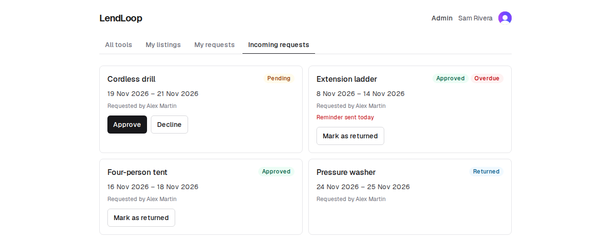
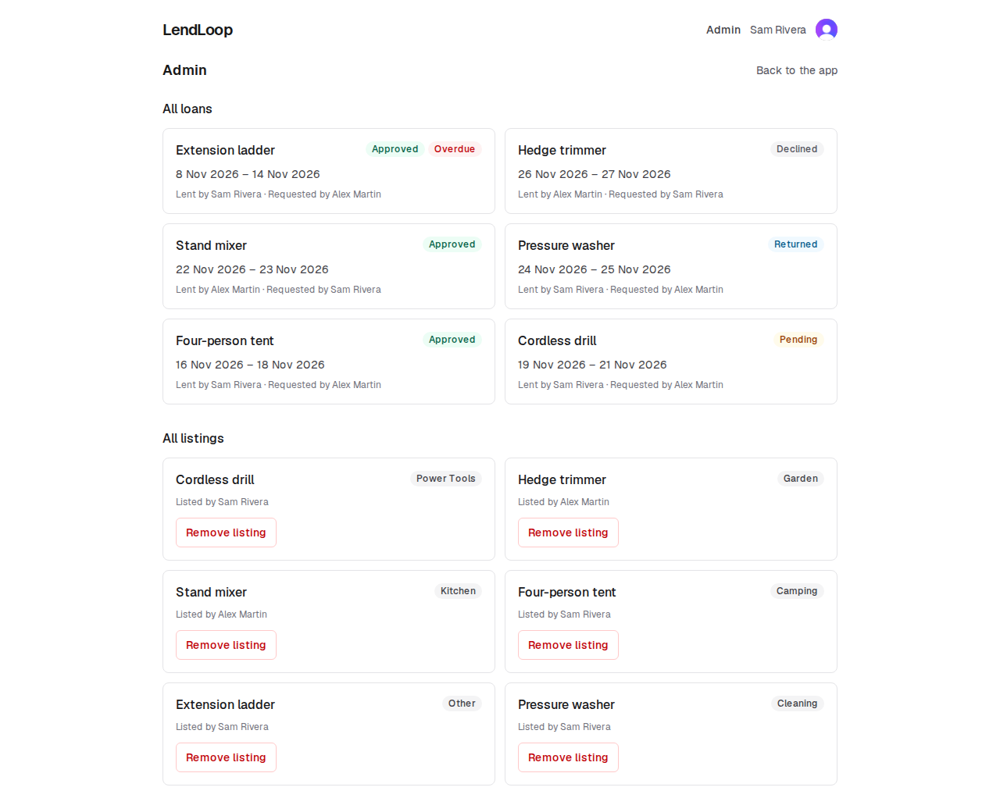
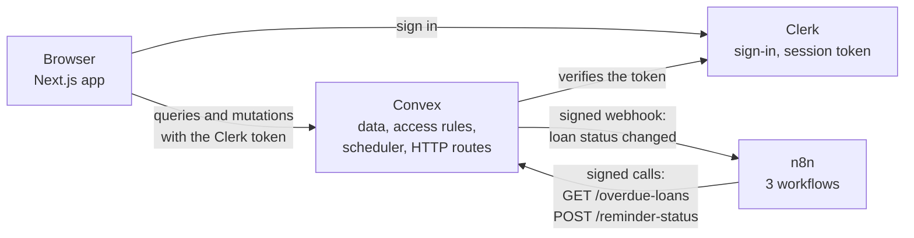

# LendLoop

**Borrow what you need. Lend what you don't.**

LendLoop lets neighbours lend tools to each other. A member lists a tool,
another member asks to borrow it for given dates, and the owner approves or
declines. n8n sends a notification at every step and reminds borrowers when a
tool is overdue.

Take-home project for the Full-Stack Developer position at Fluence
International.

## Contents

- [Demo](#demo)
- [Tech stack](#tech-stack)
- [Architecture](#architecture)
- [Local setup](#local-setup)
- [Environment variables](#environment-variables)
- [Access control](#access-control)
- [Security and data minimization](#security-and-data-minimization)
- [n8n integration](#n8n-integration)
- [Testing](#testing)
- [What I'd change for production](#what-id-change-for-production)

## Demo

All names and data in these screenshots are fictional.

**Public page.** No sign-in needed. It shows the name and category of each
tool and nothing else.



**All tools.** Signed-in members see the availability, the lender's name, the
booked dates, and can ask to borrow a tool.



**My requests.** The borrower follows each request. An overdue loan shows when
the last reminder was sent.



**Incoming requests.** The owner approves, declines, or marks a tool as
returned.



**Admin.** An admin sees every loan and can remove any listing.



## Tech stack

| Layer | Technology |
|---|---|
| Frontend | Next.js 16 (App Router), React 19, TypeScript, Tailwind CSS 4 |
| Authentication | Clerk |
| Data and backend logic | Convex (queries, mutations, actions, HTTP routes, scheduler) |
| Automation | n8n 2.47, run locally with Docker Compose |
| Tests | Vitest with `convex-test` |

## Architecture



- The browser never decides anything about access. Every rule is checked
  inside a Convex function, using the identity from the Clerk token.
- Convex and n8n talk in both directions. Every call is signed with
  HMAC-SHA256 and carries a timestamp.
- When a loan status changes, the mutation records the event and schedules the
  notification in the same transaction. The user never waits for n8n, and
  nothing is sent if the mutation fails.

### Project layout

```
app/                  Pages: public page, /app, /app/admin
components/           UI components (tools, loans, admin)
convex/               Backend
  schema.ts           Tables and indexes
  users.ts            Sign-in sync, getCurrentUser, requireAdmin
  tools.ts            Listings
  loans.ts            Loan workflow
  admin.ts            Admin functions
  notifications.ts    Signed webhook to n8n, retries
  reminders.ts        Overdue loans, idempotent reminder storage
  http.ts             Signed HTTP routes called by n8n
  signature.ts        HMAC signing and verification
  *.test.ts           Tests
n8n/workflows/        The three exported workflows
docker-compose.yml    Local n8n
```

## Local setup

You need Node.js 22, Docker, and free accounts on
[Clerk](https://dashboard.clerk.com) and [Convex](https://dashboard.convex.dev).
The whole setup takes about ten minutes.

### 1. Install

```bash
git clone https://github.com/Franckzng/lendloop.git
cd lendloop
npm install
cp .env.example .env.local
```

### 2. Clerk

Create an application in the Clerk dashboard with **Email** and **Google** as
sign-in options. Then make three changes. The app depends on each of them.

1. **Activate the Convex integration** at
   <https://dashboard.clerk.com/apps/setup/convex>. Copy the *Frontend API URL*
   it shows (`https://….clerk.accounts.dev`). You need it in step 3.
2. **Add the email and name to the session token.** In *Configure → Sessions →
   Customize session token*, set the claims to:

   ```json
   {
     "aud": "convex",
     "email": "{{user.primary_email_address}}",
     "name": "{{user.full_name}}"
   }
   ```

   Convex reads the user's email and name from this signed token, so the
   browser cannot send a false one. Without these claims, signing in fails
   with "Your account needs an email address."
3. **Require a name.** In *Configure → User & authentication → User model*,
   turn on *First and last name* and tick *Require first and last name*.

Finally, copy the two keys from *Configure → API keys* into `.env.local`:

```
NEXT_PUBLIC_CLERK_PUBLISHABLE_KEY=pk_test_…
CLERK_SECRET_KEY=sk_test_…
```

### 3. Convex

```bash
npx convex dev
```

Log in, create a project, and answer **No** to "Set up Convex AI files". The
command writes its own variables to `.env.local`, then stops because one
variable is missing. Set it with the Frontend API URL from step 2:

```bash
npx convex env set CLERK_JWT_ISSUER_DOMAIN https://your-instance.clerk.accounts.dev
```

Run `npx convex dev` again and keep it running. It deploys the functions and
watches for changes.

### 4. Run the app

In a second terminal:

```bash
npm run dev
```

Open <http://localhost:3000> and sign in. The app works at this point.
Notifications are skipped until n8n is configured.

### 5. Become an admin (optional)

Roles cannot be changed from the app. Open the Convex dashboard, go to
*Data → users*, and set `role` to `"admin"` on your own row. An *Admin* link
then appears in the header.

### 6. n8n

```bash
cp .env.n8n.example .env.n8n
openssl rand -hex 32
```

In `.env.n8n`:

- paste the generated value as `LENDLOOP_WEBHOOK_SECRET`;
- set `LENDLOOP_CONVEX_SITE_URL` to the value of `NEXT_PUBLIC_CONVEX_SITE_URL`
  from `.env.local` (it ends with `.convex.site`).

Start n8n and load the three workflows:

```bash
docker compose up -d

for name in error-handler request-notification overdue-reminders; do
  docker compose cp n8n/workflows/$name.json n8n:/tmp/$name.json
  docker compose exec n8n n8n import:workflow --input=/tmp/$name.json
done
for id in lendloopErrorHandler lendloopRequestNotif lendloopOverdueRemind; do
  docker compose exec n8n n8n publish:workflow --id=$id
done
docker compose restart n8n
```

n8n is on <http://localhost:5678>. It asks you to create a local owner account
on the first visit.

### 7. Tunnel

Convex runs in the cloud and cannot reach `localhost`, so n8n needs a public
address while you develop:

```bash
cloudflared tunnel --url http://localhost:5678
```

It prints an address like `https://some-words.trycloudflare.com`. No account
is needed. `ngrok http 5678` works the same way. Give Convex the address and
the secret:

```bash
npx convex env set N8N_WEBHOOK_SECRET <the value of LENDLOOP_WEBHOOK_SECRET>
npx convex env set N8N_REQUEST_WEBHOOK_URL https://some-words.trycloudflare.com/webhook/lendloop/request-notification
```

Ask to borrow a tool: a new execution appears in n8n under
*request-notification → Executions*.

The tunnel address changes each time `cloudflared` restarts. When it does, set
`N8N_REQUEST_WEBHOOK_URL` again.

## Environment variables

No secret is stored in the code or in the exported workflows.

**`.env.local`**, read by Next.js (not committed):

| Name | Set by | Purpose |
|---|---|---|
| `CONVEX_DEPLOYMENT` | `npx convex dev` | Which Convex deployment the CLI uses |
| `NEXT_PUBLIC_CONVEX_URL` | `npx convex dev` | Address the browser uses to reach Convex |
| `NEXT_PUBLIC_CONVEX_SITE_URL` | `npx convex dev` | Address of the Convex HTTP routes |
| `NEXT_PUBLIC_CLERK_PUBLISHABLE_KEY` | you | Clerk public key |
| `CLERK_SECRET_KEY` | you | Clerk server key, used by the Next.js proxy |

**Convex deployment**, set with `npx convex env set` or in the dashboard:

| Name | Purpose |
|---|---|
| `CLERK_JWT_ISSUER_DOMAIN` | Clerk Frontend API URL. Convex uses it to verify session tokens |
| `N8N_WEBHOOK_SECRET` | Shared secret for signing calls to n8n and verifying calls from n8n |
| `N8N_REQUEST_WEBHOOK_URL` | Address of the `request-notification` webhook |

**`.env.n8n`**, read by the n8n container (not committed):

| Name | Purpose |
|---|---|
| `LENDLOOP_WEBHOOK_SECRET` | Same value as `N8N_WEBHOOK_SECRET` |
| `LENDLOOP_CONVEX_SITE_URL` | Address of the Convex HTTP routes |
| `N8N_WEBHOOK_URL` | Public address of n8n (the tunnel address) |
| `N8N_BLOCK_ENV_ACCESS_IN_NODE` | `false`, so Code nodes can read the secret from the environment |
| `NODE_FUNCTION_ALLOW_BUILTIN` | `crypto`, so Code nodes can compute and compare HMACs |

## Access control

Every rule below is enforced inside the Convex function. The interface hides
what a user cannot do, but only as a convenience.

| Function | Who can call it | Check performed in Convex |
|---|---|---|
| `tools.listPublic` | anyone | none, by design. Returns `_id`, `name`, `category` only |
| `users.store` | signed in | identity from the Clerk token. Takes no argument. Role is always `user` on creation |
| `users.current` | anyone | returns `null` when signed out. Only the caller's own profile |
| `tools.listAll` | signed in | `getCurrentUser` |
| `tools.myListings` | signed in | `getCurrentUser`. Filtered on the caller's tools |
| `tools.create` | signed in | `getCurrentUser`. Owner is the caller. Fields validated |
| `tools.update` | owner | `getCurrentUser` and `tool.ownerId` is the caller |
| `tools.remove` | owner | same, and refused while a loan is approved |
| `loans.requestLoan` | signed in, not the owner | `getCurrentUser`. Refused on the caller's own tool. Dates and overlaps |
| `loans.approve` | tool owner | `getCurrentUser` and `loan.ownerId` is the caller. Status `pending`. Overlap |
| `loans.decline` | tool owner | same. Status `pending` |
| `loans.markReturned` | tool owner | same. Status `approved` |
| `loans.myRequests` | signed in | `getCurrentUser`. Filtered on borrower = caller |
| `loans.incomingRequests` | signed in | `getCurrentUser`. Filtered on owner = caller |
| `admin.listUsers` | admin | `requireAdmin` |
| `admin.listAllListings` | admin | `requireAdmin` |
| `admin.listAllLoans` | admin | `requireAdmin` |
| `admin.removeAnyListing` | admin | `requireAdmin`. Refused while a loan is approved |
| `admin.setTrustedLender` | admin | `requireAdmin` |
| `GET /overdue-loans` | n8n | valid HMAC signature and recent timestamp |
| `POST /reminder-status` | n8n | valid HMAC signature and recent timestamp |

The notification and reminder functions are `internal`: they cannot be called
from a browser at all.

### Loan rules

```
pending ──approve──> approved ──mark as returned──> returned
   └─────decline───> declined
```

- A member cannot borrow their own tool.
- A request cannot overlap an approved loan. Dates are inclusive: a loan
  ending on the 5th blocks one starting on the 5th.
- The overlap is checked again at approval, in case two competing requests
  are both pending.
- Any other transition is rejected with a message naming the current status.

## Security and data minimization

**The role never comes from the client.** `users.store` takes no argument. It
reads the identity from the verified Clerk token, always creates the account
with the role `user`, and never changes the role of an existing account. An
admin is made by editing the database.

**Ownership comes from the server.** `tools.create` sets the owner to the
signed-in user. `loans.requestLoan` copies the owner from the tool. Convex
rejects any extra field sent by a client, such as `ownerId`, `role` or
`status`.

**Each audience gets only what it needs.**

| Audience | Receives |
|---|---|
| Signed-out visitor | Tool name and category |
| Signed-in member | Tool details, lender's name, booked dates without the borrower |
| Borrower and owner of a loan | Each other's name, dates, status |
| Admin | All loans and listings, and users' emails |
| n8n, per notification | Event id, loan id, status, one recipient email, tool name, timestamp |
| n8n, per overdue loan | Loan id, borrower email, tool name, end date |

No email address is ever sent to another member. A user who signs up without
a name is shown as "Neighbour", never as their email.

**Choices worth explaining.**

- *Only the owner marks a tool as returned.* The owner is the one who sees it
  come back. A borrower able to do it could free the tool without returning it.
- *An overdue tool stays "On loan".* It is unavailable until the owner marks
  it as returned, not until its end date.
- *An admin follows the same deletion rule as an owner.* A listing with an
  approved loan cannot be removed, so no borrower is left holding a tool that
  no longer exists in the app.
- *Being a Trusted Lender grants nothing.* It is a badge, not a role.
- *Every list has an upper bound*, so no query can grow without limit.
- *Dates are calendar days in UTC*, computed by the server. A client cannot
  claim a different "today".

## n8n integration

Three workflows are exported in [`n8n/workflows/`](n8n/workflows/).
[`n8n/README.md`](n8n/README.md) has more detail and `curl` commands to try the
signature by hand.

| Workflow | Trigger | What it does |
|---|---|---|
| `request-notification` | Webhook called by Convex | Verifies the signature, builds the notification |
| `overdue-reminders` | Every day at 08:00 UTC | Reminds borrowers of overdue loans, reports back to Convex |
| `error-handler` | Any failure of the two above | Records which workflow and node failed, and why |

Notifications and reminders are mock deliveries: the workflow builds the
message and keeps it in the execution data. Replacing the mock node with an
email node is the only change needed to send them.

### Signature

Every call, in both directions, carries two headers:

```
X-LendLoop-Timestamp: <milliseconds since epoch>
X-LendLoop-Signature: HMAC-SHA256(secret, timestamp + "." + body), in hex
```

The receiver recomputes the signature over the raw body it received, compares
it in constant time, and rejects a timestamp more than 5 minutes away from its
own clock. A rejected call gets a `401` with no detail. Since the timestamp is
part of the signed text, an attacker cannot reuse an old signature with a new
timestamp.

n8n reads the secret from its environment, so the exported workflows contain
no secret.

### Convex to n8n: status notifications

A request is created, approved, declined or returned. The mutation records an
event in `automationEvents` and schedules an internal action with
`ctx.scheduler.runAfter(0, …)`. The action posts six fields to n8n:
`eventId`, `loanId`, `status`, `recipientEmail`, `toolName`, `timestamp`.

A new request notifies the owner. Every later change notifies the borrower.

### n8n to Convex: overdue reminders

Once a day the workflow calls `GET /overdue-loans`, builds a reminder for each
loan not yet reminded today, and reports each one with
`POST /reminder-status`.

### Idempotency

- **Reminders.** The key is `<loanId>:<YYYY-MM-DD>`, so there is at most one
  reminder per loan and per day. If the key is already stored, Convex answers
  `200` and writes nothing. Running the workflow twice the same day, or a
  retry after a timeout, cannot create a duplicate. Convex refuses a key that
  does not have this exact shape.
- **Notifications.** The `eventId` stays the same across retries, so a
  receiver can recognise a second delivery of the same event.
- **Sign-in.** `users.store` finds the account by its Clerk id before
  inserting, so signing in again never creates a second account.

### Retries and failures

- **Convex to n8n.** Up to 3 attempts: immediately, after 30 seconds, after
  2 minutes. Each retry is a newly scheduled function, signed again with a
  fresh timestamp. A `4xx` answer is not retried, because the same request
  would be refused again. A delivery that fails for good is logged and
  recorded in `automationEvents` as `notification_failed`.
- **n8n to Convex.** Both HTTP nodes use "Retry On Fail" (3 tries, 2 seconds
  apart). If Convex is still unreachable, the execution fails and n8n runs
  `error-handler`, so a failure is never silent.
- **Without n8n.** If the webhook address or the secret is not set, the app
  keeps working and notifications are skipped with a warning in the logs.

## Testing

```bash
npm test            # 45 tests, about one second
npx tsc --noEmit    # types
npm run lint        # ESLint
```

The tests run the real Convex functions against an in-memory backend
(`convex-test`). They cover:

- **Access rules:** a user cannot edit or delete another user's tool, a user
  cannot call any admin function, a borrower cannot approve, decline or mark
  as returned.
- **Roles:** always `user` on sign-up, unchanged on sign-in, never accepted
  from the client.
- **Data minimization:** the exact fields of the public list, of the
  notification payload and of the overdue list.
- **Loan workflow:** overlaps, competing approvals, every invalid transition.
- **Signature:** checked against a value computed with OpenSSL. Rejection of a
  wrong secret, an old timestamp, and a body changed after signing.
- **Reliability:** retries, permanent failure, no notification when the
  mutation fails, a single row when the same reminder is reported twice.

## What I'd change for production

**Secrets**

- Rotate the webhook secret on a schedule. To rotate without downtime, accept
  two secrets during the changeover, identified by a key id header.
- Keep secrets in a secret manager rather than in `.env` files.

**Reliability**

- Put a durable queue between Convex and n8n, with a dead-letter queue.
  Today a notification is dropped after three attempts.
- Deduplicate on `eventId` inside the n8n workflow. The id is already sent,
  but the mock notification does not check it yet.
- Run n8n with a real database, in queue mode, with external task runners,
  on a stable domain instead of a tunnel.

**Security**

- Sign the HTTP method and path as well as the body. A signed `GET` has an
  empty body, so within the 5 minute window a captured request could be
  replayed against another signed `GET` route. Today there is only one.
- Store used timestamps or nonces for 5 minutes to block replays completely.
- Rate limit sign-in and the mutations that create data, such as loan
  requests.
- Add an audit log of admin actions: who removed which listing, who granted
  the Trusted Lender badge, and when.

**Operations**

- Separate production instances of Clerk and Convex, with their own keys.
- Error tracking and alerting (Sentry or Datadog) on the frontend, on Convex
  functions, and on the n8n error workflow, which today only records failures.
- Scheduled Convex backups, with a tested restore.
- CI on every pull request: lint, type check and tests, plus a check that no
  secret is committed.

**Product**

- Send real emails, with an unsubscribe link and a stored delivery status.
- Handle time zones. Days are counted in UTC today, so "today" can differ
  from the user's own date around midnight.
- Paginate the lists. They are capped at 100 or 200 items for now.
- Let a borrower cancel a pending request, and let the owner propose other
  dates.
- Manage roles from an admin screen, with a confirmation step and an audit
  entry, instead of editing the database.
- Add end-to-end browser tests to the repository.
